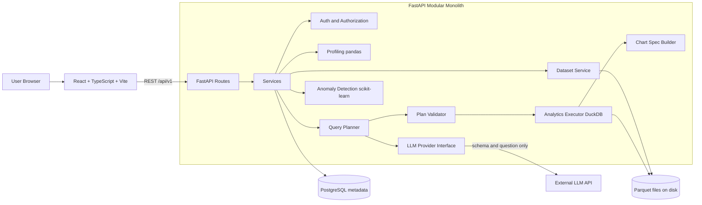
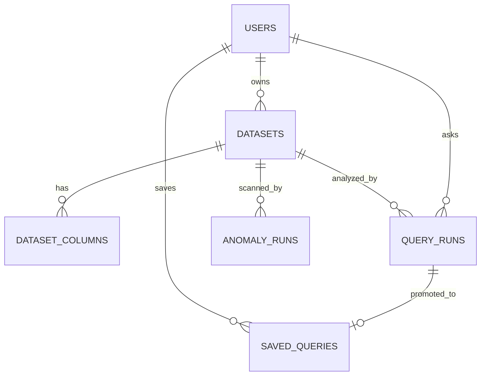

# Architecture

DataPilot AI is a **modular monolith**: one FastAPI deployable with clear internal module boundaries, plus a React frontend.

## System overview

## Design principles

1. **PostgreSQL stores metadata only** (users, datasets, history). Uploaded data lives as Parquet files and is queried with DuckDB.
2. **The analytics engine is independent of the LLM**, so it can be tested with hand-written query plans.
3. **The LLM sits behind an interface**, so providers can be swapped.
4. **The model never executes anything.** It returns a structured plan that is validated and then executed by the backend.

## Safe query pipeline

1. Build minimal context (column names, types, small stats; no raw rows by default)
2. LLM returns a JSON query plan
3. Pydantic schema validation (reject if invalid)
4. Semantic validation: columns exist, aggregates fit the types, allow-listed operators, enforced limits
5. Compile the plan to parameterized DuckDB SQL
6. Execute read-only with a timeout and a row cap
7. Build the chart spec deterministically from the result shape
8. Generate the explanation from computed values only, then verify the numbers

## Database model

| Table | Purpose |
|-------|---------|
| users | Accounts with hashed passwords |
| datasets | Uploaded file metadata, status, profile (JSONB) |
| dataset_columns | Per-column type and statistics |
| query_runs | Question, validated plan, status, latency (analysis history) |
| saved_queries | Plans the user saved for re-running without the LLM |
| anomaly_runs | Anomaly detection runs and metrics |

Every dataset-scoped query filters by owner to guarantee user isolation.